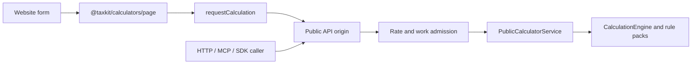
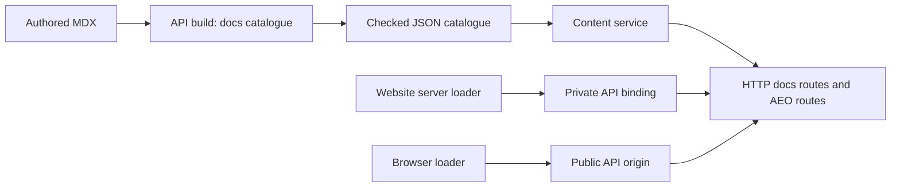

# Architecture

TaxKit is an open-source Australian tax engine with a public API, a TypeScript
SDK and a documentation Website. The engine is deterministic: the same checked
facts, rules, parameters and dates always produce the same report and trace.
The API Worker serves calculations, documentation, discovery files and share
images. The Website renders the calculators and the documentation and reads
everything from the API. There is no database or sign-in.

## Owners and imports

| Owner                                                | Responsibility                                                                                                                                              |
| ---------------------------------------------------- | ----------------------------------------------------------------------------------------------------------------------------------------------------------- |
| `packages/core` — `@taxkit/core`                     | Money and date primitives, fact/rule/parameter descriptors, graph validation, traces, ledgers and the `CalculationEngine`                                   |
| `packages/rules/au/*` — `@taxkit/rules-au-*`         | Australian take-home pay and PAYG withholding, annual income tax and STSL rule packs                                                                        |
| `packages/calculators` — `@taxkit/calculators`       | Calculator catalogue, metadata, graph, calculation dispatch and expected errors; the browser calculator page: forms, page atoms, view Schema and page tools |
| `packages/api/http` — `@taxkit/api-http`             | Native HTTP contract and handlers, the route catalogue, cache policy, `Accept` negotiation and the generated client's named reads and errors                |
| `packages/api/mcp` — `@taxkit/api-mcp`               | Remote MCP tools over the calculator and content services                                                                                                   |
| `content/docs` — `@content/docs`                     | Authored MDX pages, navigation and repository link revisions                                                                                                |
| `packages/content` — `@taxkit/content`               | Page Schemas, the checked reading body, catalogue, content service, page addresses and head metadata, and the share-image contracts                         |
| `packages/mdx` — `@taxkit/mdx`                       | Content-neutral document compiler, renderer contracts and code highlighter                                                                                  |
| `packages/diagrams` — `@taxkit/diagrams`             | Mermaid to SVG adapter for MDX                                                                                                                              |
| `packages/aeo` — `@taxkit/aeo`                       | Robots, sitemap, `llms.txt`, `llms-full.txt` and share-image routes                                                                                         |
| `packages/og-image` — `@taxkit/og-image`             | Build-time Takumi share-image renderer                                                                                                                      |
| `packages/webmcp` — `@taxkit/webmcp`                 | Browser WebMCP host adapter and calculator page tool registration                                                                                           |
| `packages/analytics` — `@taxkit/analytics`           | Hosted calculator usage events, with no tax inputs or results                                                                                               |
| `packages/observability` — `@taxkit/observability`   | Stage names, edge identity and the one host request record                                                                                                  |
| `packages/infrastructure` — `@taxkit/infrastructure` | Deployment only: Worker declarations, hostnames, secrets, the retained zone, PostHog and telemetry stacks                                                   |
| `packages/sdk/typescript` — `taxkit`                 | The published SDK: plain, safe-result, Effect and AU entry points                                                                                           |
| `apps/api`                                           | Builds the docs catalogue ahead of time; composes the native API Worker and the standalone Bun host                                                         |
| `apps/web`                                           | TanStack Start Website: routes, views, host settings, the private API binding and the two runtimes                                                          |

Each private package exports its TypeScript source directly (no build, `dist`
or export condition) and has no runtime of its own. Only the SDK builds; it
compiles the private sources it includes. No package imports an app. Engine packages do not
import application packages; callers turn their own state into checked input
facts before calculating. All owned code follows the strict Effect skill.

## Engine model

```txt
Schema-branded domain values
  -> Schema.TaggedClass facts
  -> Context.Service fact and service providers
  -> Layer.effect rule derivations
  -> Layer-composed rule packs
  -> typed calculator programs
  -> trace, ledger, graph and report output
```

Yearly parameters stay separate from algorithms. Traces and graph validation
are part of every calculation. See [facts](docs/architecture/facts.md),
[rules and parameters](docs/architecture/rules-and-parameters.md),
[calculators](docs/architecture/calculators.md) and
[graph, trace and ledgers](docs/architecture/graph-trace-ledgers.md).

## A calculation



The browser calls the API's public origin directly with the generated
`HttpApiClient`. The server never calculates. A page's form becomes one checked
request; an edit interrupts unfinished work and keeps the last answer marked
out of date. On a browser with WebMCP, the same page commands are offered as
five page tools.

## A documentation page



The API build uses `@taxkit/content/catalogue` to read every page once and write
the checked catalogue. The separate runtime export `@taxkit/content/live` only
reads that catalogue; the
Worker decodes it on first use, so no request parses MDX. The Website reads
pages, navigation, search and Markdown through the generated client. It serves
`.md` files, answers a Markdown `Accept` preference with a 307 to that file,
and forwards `/sitemap.xml`, `/robots.txt`, `/llms*.txt` and `/og/<page>.png`
once to the API. Head metadata comes from Content's `docsPageMetadata`.

## Runtimes

`apps/web/src/lib/runtime.server.ts` owns the one server runtime. It provides
the checked Website settings, the private API binding and host telemetry.
`runtime.client.ts` owns the browser loader bridge, and `api-client.atoms.ts`
the native `AtomHttpApi.Service` client sharing one Atom registry with React.
TanStack owns loader data and freshness. The API Worker builds its services
once per isolate in Alchemy's instance scope; each request keeps its own fibre.

`apps/web/src/lib` keeps only the Website's own code, in `host/`, `http/`,
`pages/`, `docs/`, `calculators/` and `seo/`. See [frontend](docs/architecture/frontend.md),
[Effect services](docs/architecture/effect-services.md) and
[configuration](docs/architecture/configuration.md).

## Caching

Both Workers use native version-scoped Cloudflare caching. A successful public
GET or HEAD gets `Cache-Control: public, max-age=0` and seven days of CDN
freshness. A Markdown redirect, 400 or 406 that varies on `Accept` is stored
beside its page, because an uncacheable reply at a page address would evict the
cached page. Errors, other methods and anything setting a cookie are
`no-store`. Share images are rendered when the API is built; the Worker only
reads the finished PNG, and the CDN keeps it for the deployed version.

## Deployment and local development

One Alchemy stack, `alchemy.run.ts`, declares the API and Website for every
stage. `prod` and `pr-<number>` stages use cloud state and Doppler and deploy
together through native Alchemy. A `dev_*` stage runs only under `alchemy dev`,
in local emulation with local state and no credentials; `bun run dev` starts it.
See [deployment](docs/architecture/deployment.md) and the
[deployment runbook](docs/runbooks/deployment.md).

## Checks

`bun run verification` runs the five checks in order: `build`, `lint`
(formatting, Oxlint, documentation links and portable paths), `check-types`
(with Effect diagnostics), `knip` and `test` (tool, unit and browser tests, then
the native Website/API pair suite). Each workspace keeps its tests in `test/`.
A local pass does not prove a deployment. See
[testing and quality](docs/architecture/testing-and-quality.md).

## Decisions

The [docs index](docs/README.md) lists the architecture decision records.
